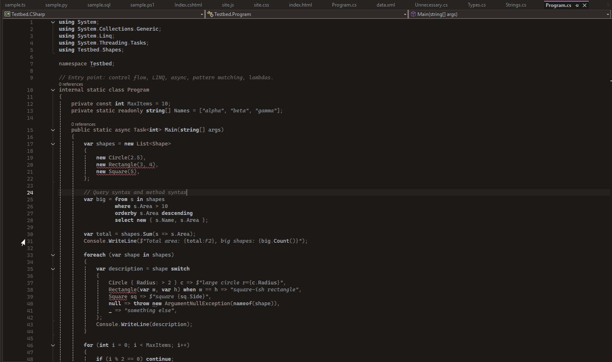
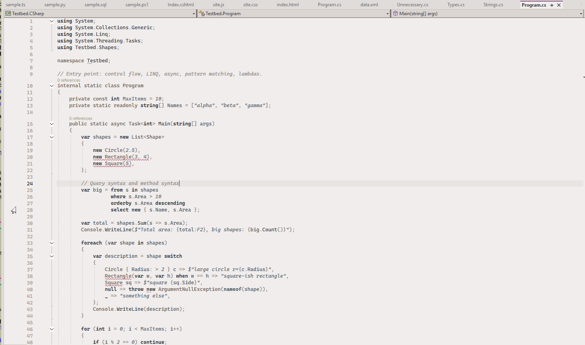

# Zenbones for Visual Studio

The [zenbones](https://github.com/zenbones-theme/zenbones.nvim) collection of
contrast-based color themes for **Visual Studio 2022 and 2026**.

Zenbones was created by [Michael Chris Lopez (@mcchrish)](https://github.com/mcchrish).
All credit for the color design goes to the original project; this repo only
ports the themes to Visual Studio. This is an unofficial port, not affiliated with the
zenbones project.





This port was built with [Claude Code](https://claude.com/claude-code), Anthropic's AI coding assistant.

## Install

Install **Zenbones Themes** from the
[Visual Studio Marketplace](https://marketplace.visualstudio.com/items?itemName=OskariLindroos.ZenbonesThemes),
or in Visual Studio under **Extensions → Manage Extensions**. Each
[GitHub release](https://github.com/oskarilindroos/zenbones-visualstudio/releases)
also has the `.vsix` attached.

All 19 variants are included and appear under
**Tools → Options → Environment → General → Color Theme**:

| Scheme | Variants |
| --- | --- |
| Zenbones | Light, Dark |
| Zenwritten | Light, Dark |
| Neobones | Light, Dark |
| Forestbones | Light, Dark |
| Rosebones | Light, Dark |
| Tokyobones | Light, Dark |
| Seoulbones | Light, Dark |
| Vimbones | Light |
| Nordbones, Duckbones, Zenburned, Kanagawabones | Dark |

## Bold and italics

Zenbones conveys a lot through font style: italic comments, strings and
constants, bold keywords. Visual Studio themes can only carry colors, so the
extension includes a small editor component that adds the styles at runtime,
using the same per-variant styles as the Neovim originals. It only does this
while a zenbones theme is active (detected from the editor background), and
removes them again when you switch to another theme.

Turn italics or bold off under **Tools → Options → Zenbones → General**.
Italics look best with a font that has a real italic, such as Cascadia Code or
Consolas.

## C# modifiers

Visual Studio's C# classifier (Roslyn) reports every keyword the same way, so
`public static class` would get the same color and bold as `return`. Zenbones,
like VS Code's C# grammar, colors modifiers and declaration keywords (`public`,
`static`, `readonly`, `async`, `class`, `namespace`, `get`/`set`, …) as types.
The extension re-tags those keywords so the themes can color them separately;
you can adjust them under **Tools → Options → Environment → Fonts and Colors →
Keyword - Modifier (Zenbones)**. With other themes the item has no colors of
its own, so keywords look exactly as before.

## How it works

The themes are generated, not hand-written. `tools/generate.py` reads the
compiled Vim colorschemes in `vendor/zenbones.nvim` (a pinned submodule), so
every color matches the Neovim originals exactly, and writes one `.pkgdef`
per theme into `src/ZenbonesTheme/Themes/`:

1. **`vimcolors.py`** parses each scheme's highlight groups for light and dark.
2. **`theme.py`** derives semantic roles (surfaces, text, syntax, diagnostics)
   from the groups and expresses them as VS Code workbench keys.
3. **`vsmap.py`** fans those keys out to ~1,500 legacy Visual Studio tokens
   using the mapping tables from Microsoft's
   [theme-converter](https://github.com/microsoft/theme-converter).
4. **`vsdirect.py`** sets editor classifications (C#, C++, XML/XAML, HTML,
   CSS, …) directly, and adds the Fluent `Shell` / `ShellInternal` tokens that
   Visual Studio 2026 reads before falling back to the legacy ones.
5. **`pkgdef.py`** compiles everything to the binary format VS loads; it's a
   port of the VSIX color compiler, so no Windows tooling is needed.
6. **`fontstyles.py`** writes `FontStyles.g.cs`, the per-variant bold/italic
   table used by the C# editor component (`FontStyleListener.cs`).

The extension's code in `src/ZenbonesTheme` is two small editor components:

- **`FontStyleListener.cs`** adds and removes bold/italic as themes change
  (see [Bold and italics](#bold-and-italics)).
- **`ModifierClassifier.cs`** re-tags C# modifier keywords
  (see [C# modifiers](#c-modifiers)).

The generator is plain Python 3.10+ with no dependencies and runs anywhere.
Only packaging the `.vsix` needs Windows.

## Development

```sh
git clone --recurse-submodules https://github.com/oskarilindroos/zenbones-visualstudio
cd zenbones-visualstudio
python3 tools/generate.py                       # regenerate Themes/*.pkgdef
python3 -m unittest discover -s tools/tests     # run the generator tests
```

The C# code has xUnit tests in `src/ZenbonesTheme.Tests`, which use fakes for
the editor services, so they run without Visual Studio. They need Windows
(WPF): run them from Test Explorer, or with
`dotnet test src/ZenbonesTheme.Tests` after building the solution. CI runs both
test suites.

To try the themes, open `ZenbonesTheme.sln` in Visual Studio (with the
**Visual Studio extension development** workload) and press **F5**. That
starts an experimental instance of VS with the extension installed; pick a
theme under Tools → Options → Environment → General.

Generated files are committed so the Windows build doesn't need Python. CI
fails if they're stale, so rerun the generator after changing `tools/`.

To update zenbones itself:

```sh
git -C vendor/zenbones.nvim pull origin main
python3 tools/generate.py
```

## Releasing

1. Bump `Version` in `src/ZenbonesTheme/source.extension.vsixmanifest` and merge it to `main`.
2. Tag that commit and push the tag:

   ```sh
   git tag v1.0.0 && git push origin v1.0.0
   ```

CI builds and tests the tag, creates a GitHub release with the `.vsix`, and
publishes it to the Marketplace with `marketplace/publishManifest.json` (the
listing page is `marketplace/overview.md`). Publishing runs in the
`marketplace` environment, which holds the `VS_MARKETPLACE_TOKEN` secret: an
Azure DevOps personal access token with the **Marketplace (Manage)** scope.

## Limitations

- So far only tested on Visual Studio 2022. The Visual Studio 2026 (Fluent)
  tokens follow Microsoft's migration guide but haven't been checked in 2026 yet.
- Visual Studio applies its own opacity to some editor highlights (selection,
  current line). The generator compensates so the color you see on screen
  matches zenbones.

## Credits

- Theme design and colors: [zenbones.nvim](https://github.com/zenbones-theme/zenbones.nvim)
  by [Michael Chris Lopez](https://github.com/mcchrish) (MIT).
- Token mapping data in `tools/zbvs/data` from
  [microsoft/theme-converter](https://github.com/microsoft/theme-converter)
  (MIT, see `tools/zbvs/data/LICENSE.theme-converter`).

## License

[MIT](LICENSE)
